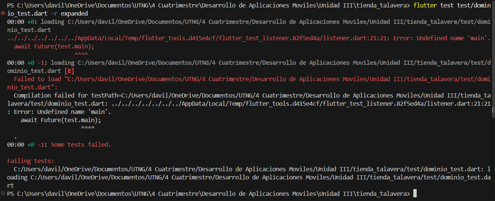
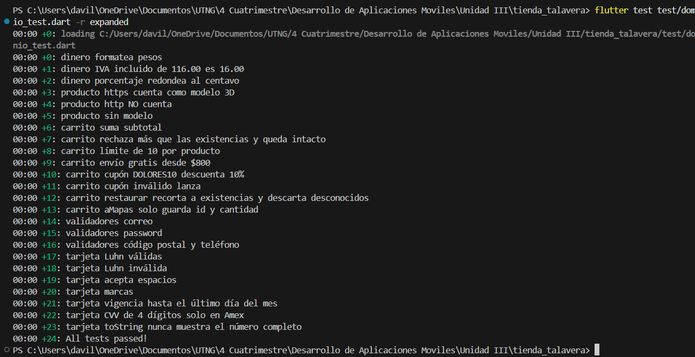
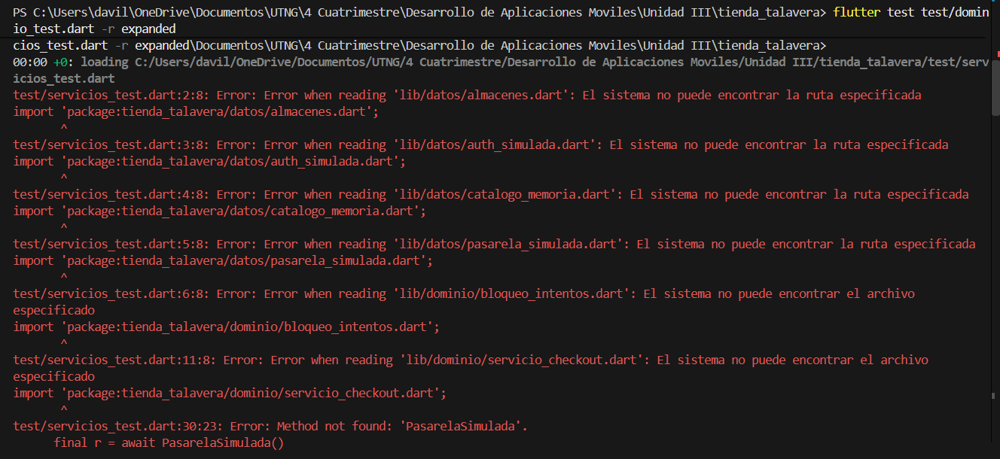
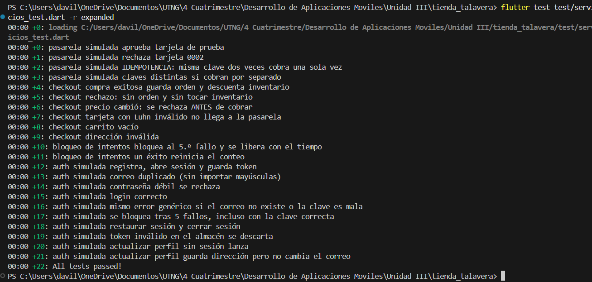
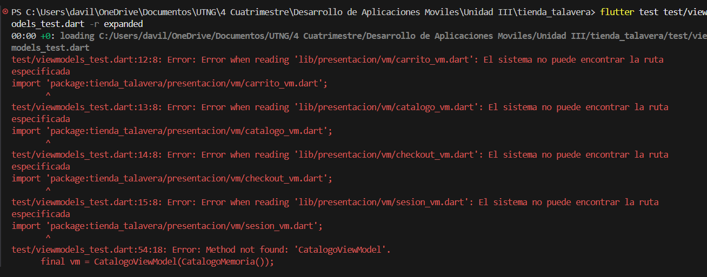
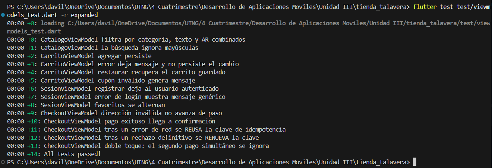

# Tienda Talavera

Módulo de comercio de **Super Dolores** enfocado en la tienda **Talavera del Centro** (Dolores Hidalgo), desarrollado siguiendo el ciclo de pruebas **ROJO / VERDE** en Flutter.

---

## 1. Dominio y reglas base

Rojo: las pruebas de dominio fallan antes de completar las reglas y modelos base.

Verde: pasan las pruebas de dominio (monedero, eventos, permisos y reglas base).

---

## 2. Servicios de comercio (Talavera del Centro)

Rojo: las pruebas de servicios fallan antes de implementar el catálogo, existencias, comisión e idempotencia de la tienda.

Verde: pasan las pruebas de servicios con **Talavera del Centro** (`Taza de Talavera` y `Jarrón azul`), control de inventario, comisión de plataforma e idempotencia.

---

## 3. ViewModels de presentación

Rojo: las pruebas de ViewModels fallan antes de conectar el estado de la tienda y el carrito con la interfaz.

Verde: pasan las pruebas de ViewModels con el flujo completo de selección, carrito y compra.

###Pantallas funcionando

<table>
  <tr>
    <td align="center">
      
      
<strong>Pantalla 1</strong>

    </td>
    <td align="center">
      
      
<strong>Pantalla 2</strong>

    </td>
    <td align="center">
      
      
<strong>Pantalla 3</strong>

    </td>
  </tr>
  <tr>
    <td align="center">
      
      
<strong>Pantalla 4</strong>

    </td>
    <td align="center">
      
      
<strong>Pantalla 5</strong>

    </td>
    <td align="center">
      
      
<strong>Pantalla 6</strong>

    </td>
  </tr>
</table>

